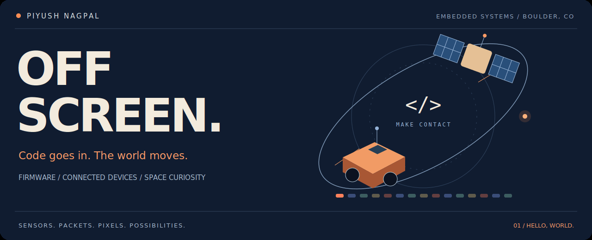
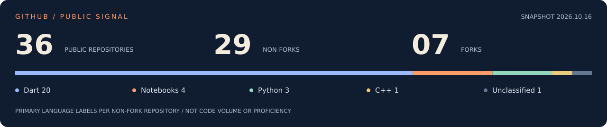
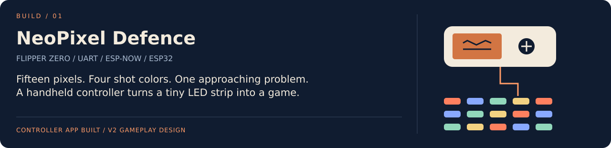
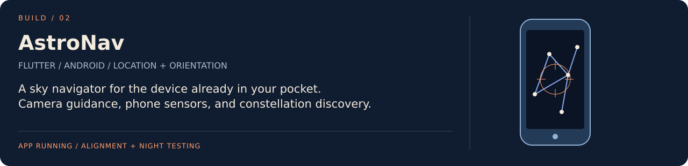
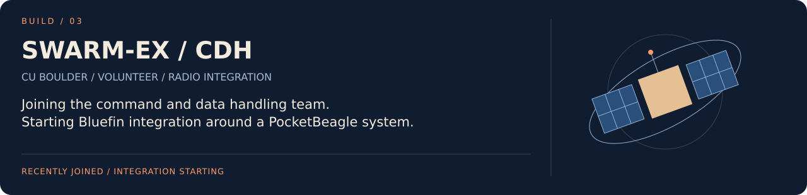
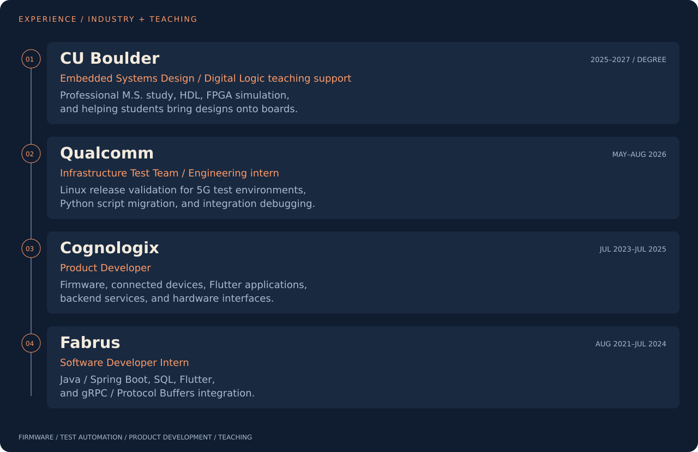
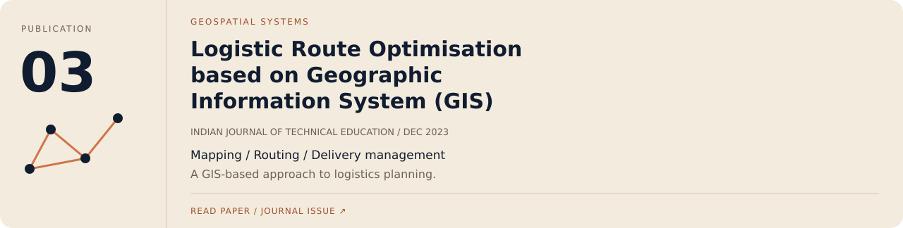

  

  <a href="#open-a-channel"><b>EXPLORE THE CODE</b></a> &nbsp; / &nbsp;
  <a href="#in-progress">BUILDS</a> &nbsp; / &nbsp;
  <a href="#experience">EXPERIENCE</a> &nbsp; / &nbsp;
  <a href="#research">RESEARCH</a> &nbsp; / &nbsp;
  <a href="https://www.linkedin.com/in/piyush-nagpal/">LINKEDIN</a> &nbsp; / &nbsp;
  <a href="mailto:piyushnagpal777@gmail.com">SAY HELLO</a>

### Hi, I’m Piyush. I like giving code something physical to do.

Read a sensor. Move a rover. Send a packet. Turn fifteen LEDs into a game.

I build across **firmware, electronics, and the apps that connect to them**. I’m pursuing a **Professional M.S. in Embedded Systems Design at CU Boulder**, after two years in product development. My favorite problems tend to live where two systems meet.

## 01 / The public signal

The code here includes **Flutter applications, connected-device experiments, Python projects, and earlier machine-learning work**. My current direction is embedded systems, connected hardware, and space systems.

**[Browse repositories ↗](https://github.com/its-me-piyush?tab=repositories)** · **[Public activity ↗](https://github.com/its-me-piyush?tab=overview)**

Snapshot: October 16, 2026. Language labels count non-fork repositories, including this profile. They describe this public collection, not proficiency, code volume, or private work.

## 02 / Open a channel

| If you’re curious about… | Start here | Follow the code |
| :--- | :--- | :--- |
| **A phone talking to a device** | [BLE Chat + Time-Series Data](https://github.com/its-me-piyush/BLE-Chat-app-with-time-series-data) | [Flutter / Dart application](https://github.com/its-me-piyush/BLE-Chat-app-with-time-series-data/tree/HEAD/lib) |
| **An app and its embedded counterpart** | [Hostel IoT App](https://github.com/its-me-piyush/hostel_app_i2it) | [App](https://github.com/its-me-piyush/hostel_app_i2it/tree/HEAD/lib) + [ESP8266 firmware](https://github.com/its-me-piyush/hostel_app_i2it/tree/HEAD/Arduino/Hostel_ESP8266) |
| **A camera feeding a decision** | [Driver Drowsiness Detection](https://github.com/its-me-piyush/Driver-Drowsiness-Detection-System) | [Detection script](https://github.com/its-me-piyush/Driver-Drowsiness-Detection-System/blob/HEAD/drowsiness_detection.py) + [model](https://github.com/its-me-piyush/Driver-Drowsiness-Detection-System/blob/HEAD/model.py) |

<b>Take the scenic route: notebooks, small experiments, and earlier apps</b>

- [Alzheimer’s Classification](https://github.com/its-me-piyush/Alzheimer-s-Classification) and [ResNet Classification](https://github.com/its-me-piyush/Classification-with-RESNET): earlier notebook-based machine-learning projects.
- [Keychain](https://github.com/its-me-piyush/Keychain): Python and Arduino sketch files.
- [Python Games](https://github.com/its-me-piyush/Games-with-python): five console games.

## 03 / In progress

<b>Project details / text version</b>

- **NeoPixel Defence:** a custom Flipper Zero controller app sends commands over UART to an ESP32-S2 and then over ESP-NOW to the ESP32 driving fifteen LEDs. The controller build succeeded. The V2 gameplay design adds waves, rainbow enemies, and three lives.
- **AstroNav:** app-first Android / Flutter sky navigation using location, orientation, and the phone camera. Alignment and night testing are ongoing.
- **SWARM-EX / CDH:** recently joined as a volunteer. Starting Bluefin radio integration around the PocketBeagle-based system.

Current-work snapshot: October 2026. These projects describe my wider engineering work; source links above point to verified public repositories.

<b>More hardware: electronic loads, custom boards, and a CAN-connected rover</b>

| Build | Engineering focus |
| :--- | :--- |
| **Instrument Droid** | Four-layer electronic load for VRM characterization. DAC-controlled MOSFET load, ADC measurement, calibration, and board bring-up. |
| **Golden Arduino** | Custom ATmega328 board. USB-UART, power regulation, protection, layout, and bootloader bring-up. |
| **AESD Rover** | Yocto Linux and ESP32 connected over CAN, with drive commands, telemetry, heartbeat, and emergency-stop handling. |
| **RV Awning Control** | A mobile / BLE / Linux / MQTT / CAN control prototype spanning app, gateway, motor commands, and telemetry. |
| **Deep Sleep** | Team wearable mech-duel project. BLE, motion sensing, feedback, low-power design, and energy modeling. In development. |

## 04 / Where I’ve built

<b>Experience details / text version</b>

- **CU Boulder:** Professional M.S. in Embedded Systems Design, 2025–2027. Digital Logic teaching support includes HDL, FPGA simulation, and board bring-up. Degree dates are separate from the teaching appointment.
- **Qualcomm:** Infrastructure Test Team, engineering intern, May–August 2026. Linux release validation for 5G test environments, Python test-script migration, and integration debugging.
- **Cognologix:** Product Developer, July 2023–July 2025. Firmware, connected devices, Flutter, backend services, and hardware interfaces.
- **Fabrus:** Software Developer Intern, August 2021–July 2024. Java / Spring Boot, SQL, Flutter, and gRPC / Protocol Buffers integration.

## 05 / Questions that became papers

**[ResNet / DOI ↗](https://doi.org/10.1109/SMARTGENCON56628.2022.10083966)** · **[MRI classification / author copy ↗](https://www.researchgate.net/publication/373398790)** · **[GIS routing / journal issue ↗](https://www.ijteonline.in/assets/uploads/issue_pdf/1760350414.pdf#page=62)**

<b>Publication titles and references / text version</b>

1. **A Comparative Analysis of ResNet Architectures.** Piyush Nagpal, Shivani Atul Bhinge, and Ajitkumar Shitole. 2022 International Conference on Smart Generation Computing, Communication and Networking (SMART GENCON). DOI: `10.1109/SMARTGENCON56628.2022.10083966`.
2. **Alzheimer’s Disease Stages Classification Using MRI and Deep Learning.** Piyush Nagpal and Jay Raviraj Deore. International Journal of Electrical, Electronics and Data Communication, volume 11, issue 5, May 2023, pages 42–46.
3. **Logistic Route Optimisation based on Geographic Information System (GIS).** Piyush Nagpal, Jay Raviraj Deore, Shubham Chauhan, Risil Chhatrala, Varsha Degaonkar, and Anjali Jagtap. The Indian Journal of Technical Education, volume 46, special issue, December 2023, pages 52–58.

## 06 / My usual tools

**Write** &nbsp; C · C++ · Python · Bash · Dart / Flutter  
**Run** &nbsp; STM32 · ESP32 · Raspberry Pi · ATmega328 · embedded Linux  
**Connect** &nbsp; CAN · BLE · MQTT · UART · SPI · I²C · ESP-NOW  
**Measure** &nbsp; Altium Designer · oscilloscopes · logic analyzers · ADC / DAC

---

### Next transmission?

I’m interested in **embedded firmware, flight software, communications, and systems integration**. If your project has a tricky interface or a reason to reach for a logic analyzer, I’d like to hear about it.

**[Email me ↗](mailto:piyushnagpal777@gmail.com)** · **[Find me on LinkedIn ↗](https://www.linkedin.com/in/piyush-nagpal/)**

Based in Boulder. Powered by curiosity. Usually holding chai.

